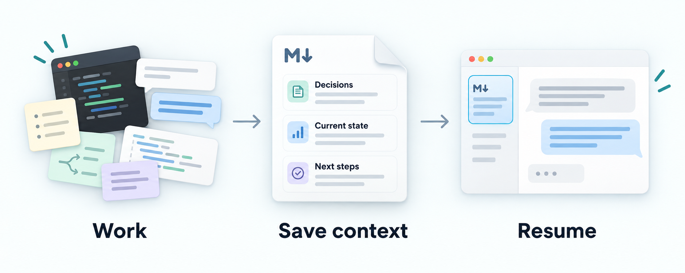

# Context Docs

**Keep decisions, current work and next steps across AI sessions.**

Context Docs helps you preserve project knowledge in readable Markdown so a new
AI session can pick up where you left off. Give your coding agent a reusable
workflow for recording what was decided and why, what is done or blocked, and
what to do next.

Designed for people without an established context-management workflow, it uses
your project's existing documents with as little setup and manual organization
as possible.



[Get started](#get-started) · [See an example](#what-you-get) · [User guide](docs/getting-started.md) · [Evidence](docs/evaluation-results.md) · [Contribute](CONTRIBUTING.md)

**Status: experimental, core skill v0.2.6 and adoption skill v0.1.15.**
The [v0.2.6 release notes](docs/releases/v0.2.6.md) cover metadata filtering,
portable references and qualified synthetic checks. The earlier candidate’s
unlinked-note coverage gap remains; the separate installed check names the note
explicitly. See [results and qualifications](docs/evaluation-results.md#more-recent-studies).
Publication and installation are separate actions. See [release history](docs/releases/README.md) for earlier
versions, feature boundaries and retained evidence.
For Codex and Claude Code · Plain Markdown · [MIT licensed](LICENSE)

## What you get

You should not have to invent a documentation system before you can preserve your
work. Context Docs gives your agent instructions to:

- **Save what matters:** decisions and their reasons, current work, blockers and next steps.
- **Keep it useful:** update stale sections, consolidate repetition and distinguish facts from proposals.
- **Fit your project:** use existing documents and choose content for their audience.
- **Help the next session start:** make the context discoverable from the README or documentation index.
- **See progress in Markdown:** show the documented goal, meaningful advances,
  blockers and next action in an existing section or a linked Markdown view.

For example, after working on an export feature, your project context might contain:

```markdown
## Current work
CSV export is implemented; empty-input behavior still needs testing.

## Decision (maintainer-approved)
Keep the existing export API to preserve compatibility.

## Next step
Test empty input before calling the feature complete.
```

*Illustrative content, not a required template.* The agent should derive entries
from your actual work and evidence. You review the changes; the next session
reads the saved context. See a fuller [before-and-after example](examples/maintenance.md).

For a runnable project, see the [Reading Queue worked example](docs/reading-queue-example.md):
a small Cloudflare app, a real feature change and step-by-step prompts.

## Get started

Install both skills, then adopt them in the project you want to maintain.
Already installed? Skip to [Use it](#use-it).

### Install in Codex

Ask Codex:

```text
Use $skill-installer to install both skills from jaredchu/context-docs:
- skills/context-docs
- skills/adopt-context-docs
Install them together in ~/.agents/skills/.
Preserve existing installations and local customizations; report version
mismatches before upgrading.
```

[Manual installation and project-only setup →](docs/getting-started.md#install-in-codex)

### Install in Claude Code

For a first installation, run these commands in a terminal:

```sh
git clone https://github.com/jaredchu/context-docs.git
cd context-docs
mkdir -p ~/.claude/skills
cp -r skills/context-docs skills/adopt-context-docs ~/.claude/skills/
```

If either skill is already installed, [review the upgrade guidance](docs/getting-started.md#upgrading)
before copying files. [Project-only setup and instruction loading →](docs/getting-started.md#install-in-claude-code)

## Use it

### 1. Set up your project

Open your project in your coding agent and invoke:

| Codex | Claude Code |
| --- | --- |
| `$adopt-context-docs` | `/adopt-context-docs` |

The adoption skill applies the context workflow and adds or reuses a maintenance
rule in the project instructions your agent loads. It preserves equivalent
existing rules and the project’s documentation layout, and reports when it cannot
confirm instruction loading.

Adoption directs the agent to start a simple inline progress path by default when
the documented goal and work support one, including during explicit re-adoption.
The guidance reuses existing views and keeps them current during everyday context
updates, without a second task list or repeated requests. Installation and upgrade
alone do not rewrite existing project setups.

### 2. Save decisions, current work and next steps

Once adopted, the project's loaded maintenance rule guides the agent to update
context after meaningful changes during normal work. You do not need to name
Context Docs in every prompt. Check that the rule is loaded and review the updates.
If an update is missed, or you want one explicitly, ask:

```text
Update this project's context from the work we just completed.
Preserve decisions and their reasons, current work, blockers and next steps.
```

Review the resulting diff. You do not need to keep a session diary or log every
interaction. If work accumulated outside the current session, use the same skill
to refresh context against current evidence:

```text
Use context-docs to refresh this project's context against current project evidence.
```

This uses existing maintenance guidance; no new skill or re-adoption is needed.
See the [refresh guidance and focused check](docs/getting-started.md#refresh-after-outside-work).
To inspect documentation without changing it, ask:

```text
Use context-docs to audit this project's context documents without editing files.
```

### 3. Resume with the saved context

Start a new session with:

```text
Read this project's context entry point and its relevant linked documents.
Use the recorded decisions, current work and next steps to continue with the next task.
```

Find the entry point in your README, documentation index, or the adoption marker’s
`Entry point:` field. Explicitly
ask the agent to read it: a saved file alone does not ensure that a new session
loads it. [More usage examples and setup details →](docs/getting-started.md#use-it)

### 4. Visualize progress in Markdown

The skills add a progress view without a web app or separate tracker:

```text
Use context-docs to visualize this project's progress in Markdown.
Show the documented goal, completed and blocked work, meaningful advances
and next action as a compact visual path. Show dependencies and put blockers
beside the work they stop. Link to sources and mark unknowns. Reuse the
existing context layout, or link a separate Markdown file if that reads better.
```

The guidance directs the agent to maintain an existing view during authorized
context updates and distinguish activity, useful learning and completed outcomes.
A possible stall requires relevant historical evidence; invented completion
percentages and claims of live agent activity are forbidden.

Favor a concise tree, arrow path or nested checklist with dependencies and blockers
visible, linking to detailed evidence while preserving decisions and existing
layouts. A flat status table alone is insufficient; there is no fixed length limit.
See the [guide](docs/getting-started.md#progress-in-markdown),
[synthetic example](examples/progress.md) and
[qualified checks](docs/evaluation-results.md#more-recent-studies).

## Two skills, one workflow

| Skill | When to use it |
| --- | --- |
| [adopt-context-docs](skills/adopt-context-docs/SKILL.md) | Set up the workflow and ongoing maintenance rule in a project. Requires the sibling core skill. |
| [context-docs](skills/context-docs/SKILL.md) | Create, maintain or audit project context. Can also be used on its own. |

Ordinary maintenance requires no background service, cloud account or runtime
dependency. The agent works during active sessions; this is not automatic
conversation capture or unlimited memory. Your project keeps ordinary, reviewable files.

## Optional logging

Most users can start with Markdown context alone. An optional event journal can
record significant history for later investigation, including when local-only
context changes without Git history. It is off by default unless you explicitly
enable it or select the auto preference. With no project logging setting, auto
applies outside Git or to explicitly selected local-only context with verified
ignored, untracked context and journal paths. Installing the skills does not enable
it. The journal helper requires Python 3.9+.

[Logging setup, upgrades and auto preference →](docs/getting-started.md#optional-logging)

Prefer context that stays out of Git? Select the opt-in
[local-only setup](docs/getting-started.md#local-only-context-excluded-from-git).
Existing setups are preserved.

## Quality and limits

The goal is useful, accurate context with less effort for people who lack an
established workflow. The project has packaging checks and recorded agent
studies, including failures and reviewer disagreements. Those studies do not yet
establish effort savings for the intended users or a skill-specific correctness
advantage. Comparisons with competent
ordinary maintenance are quality diagnostics, not a requirement to beat experts.

The skill guides an agent; it cannot guarantee factual correctness or complete
preservation, and it cannot prevent concurrent editing conflicts. Review
consequential claims and edits. It provides no automatic scheduler and grants no
permission to publish documents or change other systems. Native integration
remains experimental.

[Results, methods and limitations →](docs/evaluation-results.md)

## Explore

- [Who Context Docs fits and how it compares](docs/context-management-comparison.md) · [Live comparison](https://context-docs.com/compare/)
- [Installation and usage](docs/getting-started.md) · [Release history](docs/releases/README.md) · [Changelog](CHANGELOG.md)
- [Context standard](skills/context-docs/references/standard.md) · [Context template](skills/context-docs/assets/project-context.md) · [Decision template](skills/context-docs/assets/decision-record.md)
- [Contributing](CONTRIBUTING.md) · [Case and review templates](evals/external-validation/README.md)
- [Evaluation scenarios](evals/README.md) · [This project’s context](docs/project-context.md)

## Credits and license

Created and maintained by [Jared Chu](https://github.com/jaredchu), with
[OpenAI Codex](https://github.com/codex) and Claude contributing implementation,
documentation and evaluations. Codex led the initial AI development.
See the [contribution and attribution policy](CONTRIBUTING.md).

Released under the [MIT license](LICENSE).
